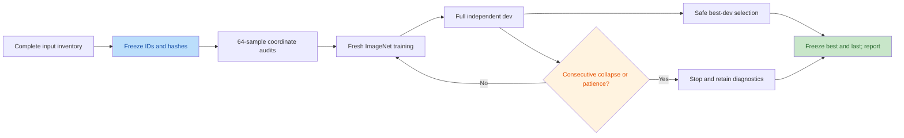

# M-S1 preflight review

Two independent validators confirmed four actionable issues, subsequently fixed:

- Count consecutive evaluations with collapse in any domain, including when
  the affected domain changes; retain individual domain counters.
- Emit explicit domain-regression events and sampling exposure at every dev
  evaluation; retain the full event history in the report.
- Reject incomplete extraction before manifest sealing, including resume mode.
- Preserve report generation when a later all-nonfinite dev evaluation lacks
  geometry metrics; missing values fail trend gates.

The proposed issue “no safe best checkpoint can be produced” was rejected by
both validators: deliberate fail-closed behavior retains last and marks the
stage ineligible rather than accepting an unsafe best.

Validated separately: a known rigid rotation has rotation-aligned residual
approximately 1.9e-14 mm; 64 RHD canonical transformations agree exactly with
audited prepared labels; four FreiHAND RGB versions map to their original
capture targets; all FreiHAND XYZ/K/MANO labels are finite; a masked NaN does
not contaminate a valid reduction. This is implementation evidence, not a
model-accuracy conclusion.

The focused failure-report regression check passed remotely: a safe early best
followed by an all-nonfinite Dex dev evaluation still produces JSON, Markdown
and curves, retains all four evaluation records and marks M-S2 ineligible.
The full subject02 filesystem inventory contains all 115,872 expected RGB and
label files (7,242 times × eight cameras × two files); no missing extraction
entries were found.
